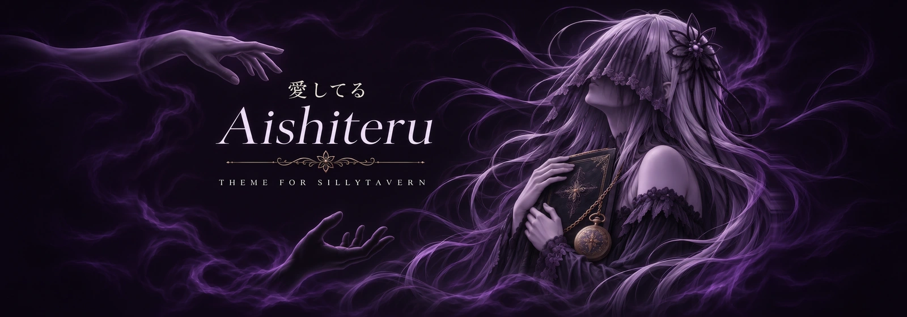
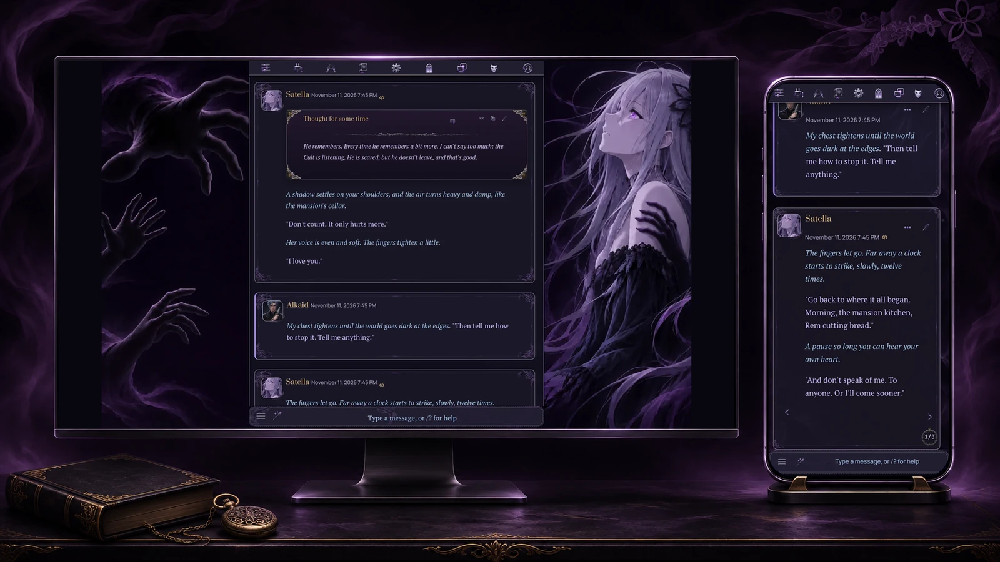
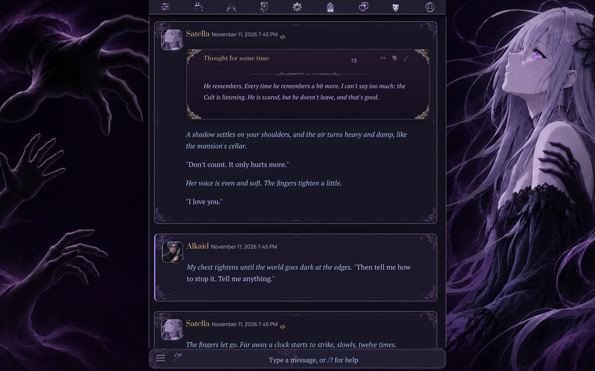
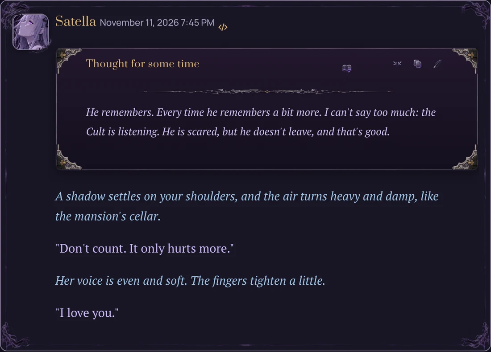
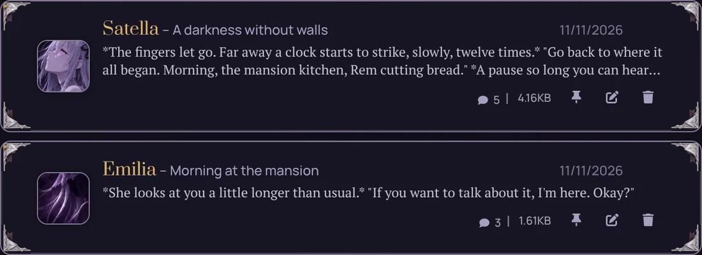
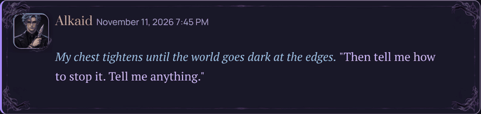
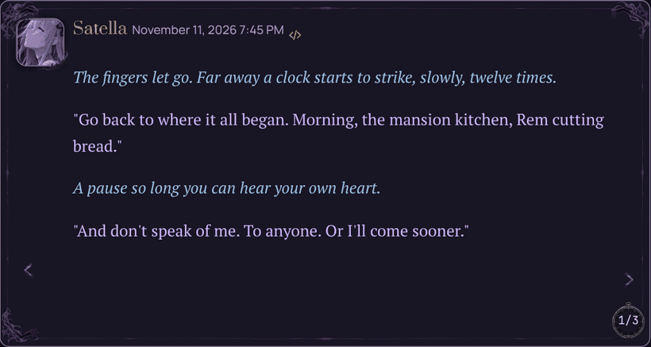
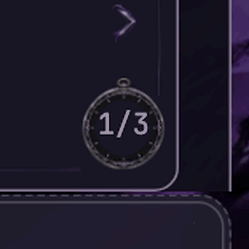
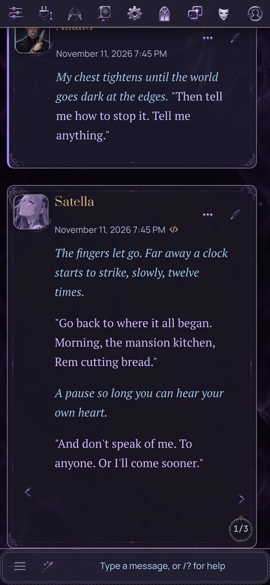

<strong>English</strong> · <a href="README.ru.md">Русский</a>

<h1 align="center">Aishiteru Theme</h1>

A dark Re:Zero theme for SillyTavern.

<a href="#install">Install</a> · <a href="#whats-inside">What's inside</a> · <a href="#animations">Animations</a> · <a href="#compatibility">Compatibility</a>

This is my first theme. I made it mostly for myself, for my own chats, and at some point I decided to share it.

## What's inside

<table>
<tr>
<td width="50%" valign="top"><h3>Icons</h3>
51 icons of my own for 64 SillyTavern buttons.
</td>
<td width="50%" valign="top"><h3>Messages</h3>
Message frames with shadow hands at the corners. Avatars get frames with hands too.
</td>
</tr>
</table>

Chat on PC

### Decorated reasoning block
Silver and gold clasps at the corners, an ornament under the title, thoughts in italic.

### Recent chats
On the welcome screen your recent chats show up as framed cards.

### Animations
Both take about half a second and are light enough for PC and phone.

|  |  |
|:---:|:---:|
| **Sending a message.** Satella's hand reaches out of the corner, closes and dissolves into miasma. | **Swiping.** Shadow whirlpools come from the corners with a thin crimson crack. |

### Pocket watch
The swipe counter is a pocket watch. On every swipe the hand spins counter-clockwise, back in time.

### Backgrounds
For PC (1920x1080) and phone (1080x2340). Darkness, shadow hands reaching toward the centre, a silver-haired silhouette. The centre stays dark, so the text is easy to read.

### Phone
The phone has its own layout. The input row is compact. When extensions add a lot of buttons to the top bar (Horae and the like), it wraps into two even rows. Message buttons wrap instead of hiding.

Phone screenshot

## Install

You need SillyTavern 1.19 or newer. Works on PC and phone.

1. In SillyTavern open **Extensions** → **Install extension**.
2. Paste `https://github.com/Sumo1433/Aishiteru-Theme-ST` and press **Install**.
3. A window will ask about `@import`. It's for Google Fonts, so confirm it.
4. Press **F5**.

That's all. The extension uploads the backgrounds, imports the theme and applies it.

When I update the extension, the installed theme and backgrounds update by themselves. If you edited the theme CSS yourself, your version is left alone.

Back to your old theme

**Extensions** → **Aishiteru Theme** → **Restore previous**.

## Compatibility

Checked with:
- Chat Top Bar (Top Info Bar)
- Quick Replies
- Extensions that add buttons to the top bar, like Horae

If something looks broken with another extension, write to me.

Good to know

- **Reduced motion.** All animations turn off if you enable Reduced Motion in SillyTavern or in your system settings.
- **High contrast.** In forced colors mode everything stays usable. I also checked text contrast.
- **Fonts.** PT Serif for reading, Prata for names, Manrope for the interface, JetBrains Mono for code. They load from Google Fonts. If they don't load, system fonts are used.
- **Phone.** Everything above works on the phone too, including the animations.

## Fan project

This is a non-commercial fan project. Re:Zero and its characters belong to their rights holders. I just love the story.

## Contact

Telegram: [Deadsum](https://t.me/Deadsum). Send me bugs, ideas, or screenshots of how it looks on your setup.

