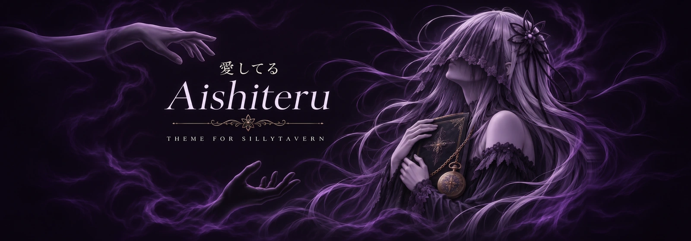
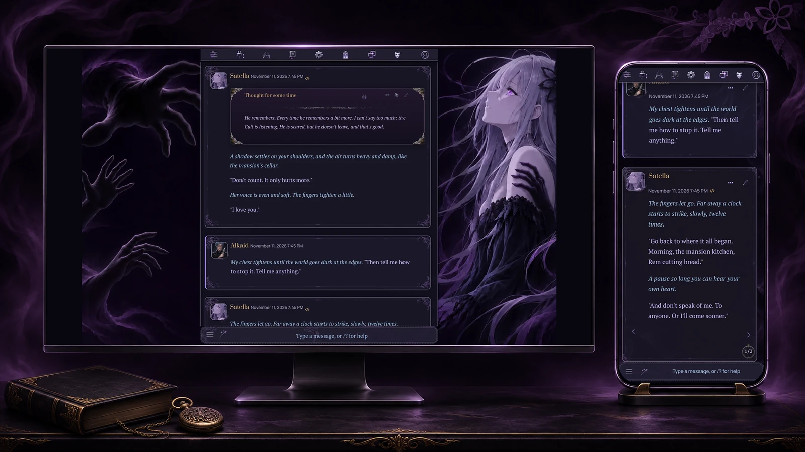
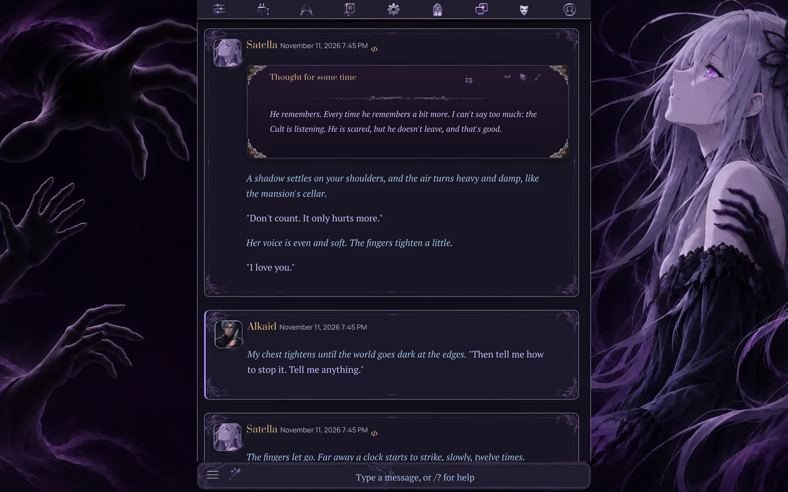
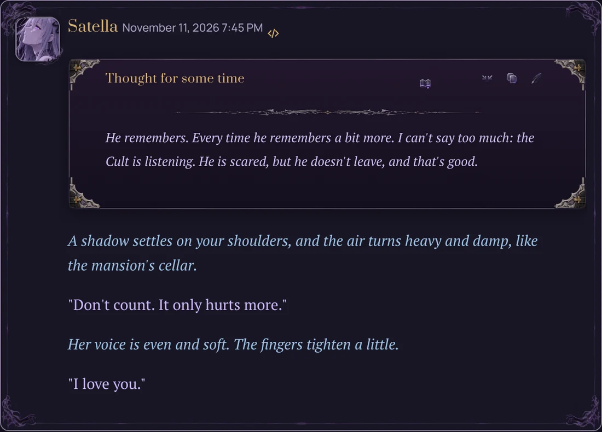
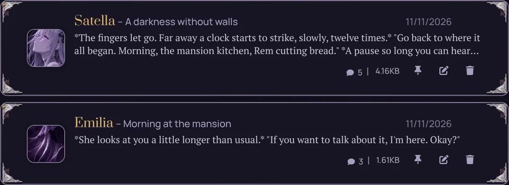
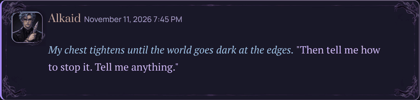
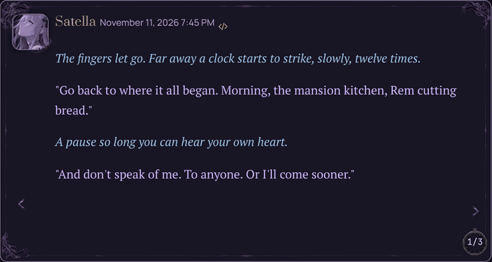
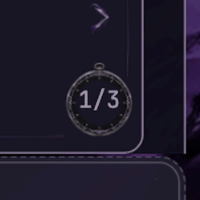
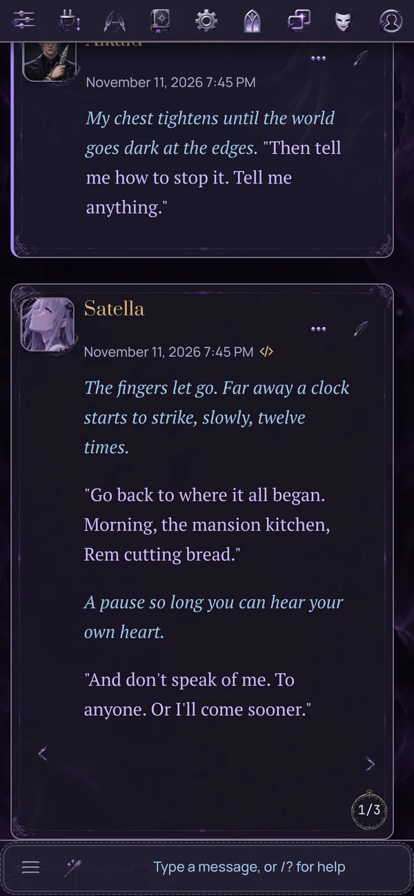

[English](README.md) · **Русский**

<h1 align="center">Aishiteru Theme</h1>

Тёмная тема по Re:Zero для SillyTavern.

Это моя первая тема. Делал её в основном для себя, под свои чаты, а потом решил поделиться. Название взято от «Aishiteru» (愛してる, «я люблю тебя»): это шепчет Субару Сателла, Ведьма Зависти. Поэтому тема получилась нежной и немного жуткой одновременно: теневые руки по углам, Евангелие, откат времени.

## Что внутри

### Иконки
51 собственная иконка на 64 кнопки SillyTavern. Чёрное серебро, лаванда, теневые руки Сателлы. Красный только у «стоп» и «удалить». У других расширений иконки остаются свои, просто подкрашиваются под тему.

### Сообщения
Рамки сообщений с теневыми руками по углам. У аватарок тоже рамки с руками.

### Размышления как страница Евангелия
Блок размышлений оформлен страницей Евангелия: серебряно-золотые застёжки по углам, орнамент под заголовком, мысли курсивом.

### Недавние чаты
На стартовом экране недавние чаты показаны карточками в рамках.

### Анимации
Обе идут примерно полсекунды и не грузят ни ПК, ни телефон.

|  |  |
|:---:|:---:|
| **Отправка сообщения.** Из угла тянется рука Сателлы, сжимается и рассыпается миазмами. | **Свайп.** Из углов закручиваются теневые воронки и проходит тонкая алая трещина. |

### Карманные часы
Счётчик свайпов сделан в виде карманных часов. На каждый свайп стрелка крутится против часовой, назад во времени.

### Фоны
Для ПК (1920x1080) и телефона (1080x2340). Тьма, теневые руки тянутся к центру, силуэт с серебряными волосами. Центр остаётся тёмным, чтобы текст нормально читался.

### Телефон
Для телефона своя раскладка. Строка ввода компактная. Если расширения накидали много кнопок в верхнюю панель (Horae и похожие), она переносится в два ровных ряда. Кнопки сообщений тоже переносятся, а не прячутся.

## Установка

Нужна SillyTavern 1.19 или новее. Работает на ПК и на телефоне.

1. В SillyTavern открой **Extensions** → **Install extension**.
2. Вставь `https://github.com/Sumo1433/Aishiteru-Theme-ST` и нажми **Install**.
3. Появится окно про `@import`. Это Google Fonts, подтверждай.
4. Нажми **F5**.

Всё. Расширение само загрузит фоны, импортирует тему и включит её.

Когда я обновляю расширение, установленная тема и фоны обновляются сами. Если ты правил CSS темы руками, обновление твою версию не тронет.

Как вернуть старую тему

**Extensions** → **Aishiteru Theme** → **Вернуть прежнюю** (Restore previous).

## Совместимость

Проверял с:
- Chat Top Bar (Top Info Bar)
- Quick Replies
- расширениями, которые добавляют кнопки в верхнюю панель, вроде Horae

Если с каким-то другим расширением что-то поехало, напиши мне.

## Полезно знать

- **Без анимаций.** Вся анимация отключается, если включить Reduced Motion в SillyTavern или уменьшение движения в настройках системы.
- **Высокая контрастность.** В режиме принудительных цветов всё остаётся рабочим. Контраст текста я тоже проверял.
- **Шрифты.** PT Serif для текста, Prata для имён, Manrope для интерфейса, JetBrains Mono для кода. Грузятся с Google Fonts. Если не загрузились, будут системные.
- **Телефон.** Всё, что выше, работает и на телефоне, анимации тоже.

## Фанатский проект

Это некоммерческий фанатский проект. Re:Zero и его персонажи принадлежат правообладателям. Я просто люблю эту историю.

## Связь

Telegram: [Deadsum](https://t.me/Deadsum). Пиши про баги и идеи, кидай скрины, как тема выглядит у тебя.

